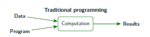
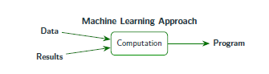

# Session 01 — Introduction to Machine Learning for Agri-Food Systems

## Overview

Agriculture is now one of the most data-rich sectors on Earth. Every day, farms, 
sensors, satellites, drones, and markets generate terabytes of information. Yet 
the vast majority of this data is never turned into a decision. This course exists 
to close that gap — by equipping you, an agri-food researcher, with the practical 
skills to apply machine learning (ML) to your own research questions.

In this opening session, you will learn what machine learning is, how it differs 
from traditional programming, when it is useful in agri-food research, and — 
crucially — how to distinguish *predictive* from *causal* questions. That 
distinction is one of the most important conceptual tools you will take away from 
this course.

---

## Learning Outcomes

By the end of this session, you should be able to:

- **Explain** what machine learning is and how it differs from traditional programming.
- **Apply** Mitchell's Task–Experience–Performance (T/E/P) framework to frame a machine learning problem.
- **Distinguish** between predictive and causal research questions in agri-food contexts.
- **Identify** at least three agri-food problems where machine learning can add value.
- **Recognise** the three families of machine learning: supervised, unsupervised, and reinforcement.
- **Describe** the standard ML workflow from raw data to deployment.
- **Formulate** a preliminary T/E/P statement for a problem from your own research.


---

## Session 01 — What is Machine Learning?


## What is Machine Learning?


**Learning outcomes:**
- Explain what machine learning is in your own words
- Describe how ML differs from traditional programming
- Apply Mitchell's T/E/P framework to an agri-food problem
- Distinguish between AI, ML, and Deep Learning

---

## 1. Why This Matters

Every year, more data is generated on farms, in food supply chains, and across 
agricultural landscapes than the year before. Sensors, satellites, drones, 
smartphones, and market platforms all produce streams of information. Yet most 
of this data is never used to inform a decision.

Consider three real scenarios from agri-food research:

- A smallholder farmer loses **30% of her maize harvest** to a disease she 
  noticed too late.
- A coffee cooperative cannot predict **which batches will fail quality checks** 
  until after shipment.
- A dairy farm wastes **20% of feed** because rationing is based on experience 
  rather than data.

In each case, the information needed to prevent the loss was already present in 
the data — it simply was not turned into a decision in time.

> **Machine learning is the set of methods that turns data into predictions, 
> and predictions into better decisions.**

This course is about giving you the skills to do that in your own research.

---

## 2. What is Machine Learning?

### 2.1 A First Working Definition

> **Machine learning is concerned with software, algorithms, and systems that 
> learn from data.**

That is the simplest useful definition. It contains three parts:

- **Software and algorithms** — the tools.
- **Systems** — where the tools are used.
- **Learn from data** — the key idea. Instead of being told the rules, the 
  system extracts them from examples.

### 2.2 Mitchell's Formal Definition

The most widely cited definition comes from Tom Mitchell (1997):

> *A computer program is said to **learn** from experience \(E\) with respect to 
> some task \(T\) and some performance measure \(P\), if its performance on 
> \(T\), as measured by \(P\), improves with experience \(E\).*

This is often called the **T/E/P framework**. It is deliberately abstract so 
that it applies to any learning problem — from playing chess to predicting 
crop yield. What changes across problems is:

- **What the task is** (T),
- **What kind of experience the program receives** (E), and
- **How performance is measured** (P).

Every machine learning problem you encounter in this course can be decomposed 
into these three elements. We will practise this in the next section.

---

## 3. A Worked Example: Detecting Diseased Maize Leaves

Imagine you want to build a system that, given a field image of a maize leaf, 
decides whether the plant is **diseased** or **healthy**.

### Task (T)

> Detecting whether a maize leaf in a field image is diseased or healthy.

The task is the specific decision the system is being asked to make. It is 
well-defined: given an image, output one of two categories.

### Experience (E)

> A labelled dataset of field images of healthy and diseased maize leaves.

The experience is the data the system learns from. Crucially, this data is 
**labelled** — each image has been tagged by a plant pathologist or trained 
technician as either "diseased" or "healthy". This is the ground truth the 
system will learn to reproduce.

A typical dataset might contain:

- 20,000 images of maize leaves in field conditions,
- labelled by experts into healthy / diseased,
- with variation in lighting, angle, growth stage, and disease severity.

### Performance (P)

> The probability with which the program correctly classifies the next leaf 
> image it is given.

The performance measure tells us how well the system is doing. Here, it is the 
**accuracy** of predictions on unseen images — not the images it was trained on, 
but new ones it has never seen before. This is the whole point: the system 
should generalise.

### The Framework in Summary

| Component | Value |
|-----------|-------|
| **Task (T)** | Detecting whether a maize leaf is diseased or healthy |
| **Experience (E)** | Labelled dataset of field images |
| **Performance (P)** | Probability of correctly classifying unseen images |

---

## 4. The Same Framework, Different Problems

Mitchell's T/E/P framework applies across every agri-food ML problem. Consider 
three more examples:

### Example 1 — Crop Yield Prediction

| | |
|---|---|
| **Task (T)** | Predict maize yield (tonnes/hectare) for a given field-season |
| **Experience (E)** | Historical records of weather, soil, management, and yield |
| **Performance (P)** | Mean absolute error between predicted and actual yield |

### Example 2 — Food Quality Grading

| | |
|---|---|
| **Task (T)** | Classify fruit into premium / standard / reject |
| **Experience (E)** | Images and sensor data of previously graded batches |
| **Performance (P)** | F1-score across the three quality classes |

### Example 3 — Irrigation Scheduling

| | |
|---|---|
| **Task (T)** | Predict soil moisture 24 hours ahead for a given plot |
| **Experience (E)** | Time-series of soil sensors, weather data, and past irrigation events |
| **Performance (P)** | Root mean squared error of moisture predictions |

In every case, notice the pattern:

- The **task** is a decision or prediction,
- The **experience** is labelled or historical data,
- The **performance** is a quantitative measure of how well the system does.

Once you can identify T, E, and P for a problem, you have done the hardest 
conceptual work in framing an ML project.

---

## 5. How is ML Different from Traditional Programming?

In traditional programming, a human writes the rules, and the computer applies 
them to data to produce results.

For example, an agronomist writes rules like:
```
if temperature > 30 and humidity > 80:
    alert("high risk of fungal disease")
```



In machine learning, the process is inverted. Instead of writing the rules, we 
provide data and results, and the machine **derives the rules** — which we call 
a **model**.

Machine learning:

```
Data + Results → Computation → Program (the model)
```



The "program" that comes out of training is the **model** — a mathematical function 
that can be applied to new data to produce predictions.

### Why This Inversion Matters

- **Traditional programming** works well when the rules are known, stable, and 
  expressible. Farm accounting is a good example.
- **Machine learning** works well when the rules are too complex, too variable, 
  or too numerous to write by hand. Disease detection from images is a good 
  example — no human can write rules that cover every visual pattern of every 
  disease under every lighting condition.

> **Key idea:** Traditional programming encodes knowledge that humans already 
> have. Machine learning extracts knowledge from data — often knowledge that 
> humans could not easily articulate.

---

## 6. Where Does ML Sit? AI, ML, and Deep Learning

These three terms are often confused. The relationship is hierarchical:

- **Artificial Intelligence (AI)** — the broad goal of making machines perform 
  tasks that normally require human intelligence.
- **Machine Learning (ML)** — a family of methods within AI that learn from 
  data, rather than being explicitly programmed.
- **Deep Learning (DL)** — a subset of ML based on neural networks with many 
  layers, especially powerful for images, audio, and text.

---

## 7. Why Now? Not 30 Years Ago?

Machine learning as a field is decades old, but its explosion into everyday 
practice is recent. Four things converged:

1. **Faster hardware** — GPUs and TPUs make large-scale computation affordable.
2. **Improved algorithms** — better architectures, optimisers, and regularisation.
3. **Explosion of data** — sensors, satellites, and smartphones, agriculture included.
4. **Excellent frameworks** — scikit-learn, TensorFlow, and PyTorch are accessible 
   to non-specialists.

The consequence is significant: **agriculture is now one of the most data-rich 
sectors on Earth.** The bottleneck is no longer data — it is the ability to turn 
data into decisions.

---

## 8. Key Ideas from This Section

> **1.** Machine learning is about learning from data, not about following 
> hard-coded rules.

> **2.** Mitchell's T/E/P framework applies to every ML problem. Once you can 
> name the Task, Experience, and Performance measure, you have framed the 
> problem.

> **3.** Traditional programming encodes known rules; ML derives rules from 
> data. Both have their place.

> **4.** AI is the goal, ML is the method, Deep Learning is a powerful subset 
> of ML.

---

## 9. Self-Check

Answer these questions in your own words. Suggested answers appear below.

1. What are the three components of Mitchell's framework?
2. In the maize leaf example, what is the **task**? What is the **experience**? 
   What is the **performance measure**?
3. Give one example of a problem that is better solved by traditional 
   programming than by ML, and explain why.
4. Give one example of a problem that is better solved by ML than by traditional 
   programming, and explain why.

<details>
<summary>Suggested answers</summary>

1. Task (T), Experience (E), Performance measure (P).

2. Task: detecting whether a maize leaf is diseased or healthy. Experience: a 
   labelled dataset of healthy and diseased leaf images. Performance: the 
   probability of correctly classifying unseen images.

3. Example: calculating a farm's profit from revenue and costs. The rules are 
   known, precise, and stable — writing a program is straightforward and 
   reliable.

4. Example: detecting disease from a leaf image. The visual patterns are 
   variable and difficult to articulate as rules; ML can learn them from 
   examples.

</details>

---

## 10. Further Reading

- Mitchell, T. M. (1997). *Machine Learning*. McGraw-Hill.
- Bishop, C. M. (2006). Pattern recognition and machine learning. Springer.
- Uyar, H., Karvelas, I., Rizou, S., & Fountas, S. (2024). Data value creation 
  in agriculture: A review. *Computers and Electronics in Agriculture*, 227, 
  109602. — For a comprehensive overview of ML applications across agriculture.
- Liakos, K. G., Busato, P., Moshou, D., Pearson, S., & Bochtis, D. (2018). 
  Machine learning in agriculture: A review. *Sensors*, 18(8), 2674. — A 
  well-cited survey of ML applications in agriculture.
  


## Session 01 — Predictive vs Causal Modelling


**Learning outcomes:**
- Distinguish between predictive and causal research questions
- Explain why most ML models are predictive tools, not causal tools
- Recognise confounding in agricultural data
- Identify which of your own research questions are predictive and which are causal

---

## 1. Why This Matters

This is one of the most important conceptual distinctions in the entire course.

Agri-food research generates data in many ways: field surveys, satellite time 
series, sensor networks, experimental trials, supply chain records. The 
questions we ask of this data fall into two broad categories:

- **Predictive questions:** *"What will happen?"*
- **Causal questions:** *"What happens if we intervene?"*

These two questions require different methods, different data, and different 
interpretations. Confusing them is one of the most common sources of error in 
data-driven research — and it has serious consequences when results inform 
policy or practice.

---

## 2. Defining the Two Types of Questions

### 2.1 Predictive Questions

A predictive question asks you to estimate an outcome from available 
information, without claiming to explain *why* the outcome occurs.

**Examples in agri-food:**

- *What will the maize yield be this season, given weather and soil data?*
- *Which batches of coffee are likely to fail quality inspection?*
- *What will the demand for dairy products be next month?*
- *Which leaves in this drone image are diseased?*

**What matters:** Accuracy of prediction on new data. The model does not need to 
know *why* yield is high — it only needs to predict reliably.

**What you can use:** Any feature that is correlated with the outcome. Even 
features that are consequences of the outcome, or that are simply proxies for 
other unmeasured variables, can be used — as long as they are available at 
prediction time.

### 2.2 Causal Questions

A causal question asks you to estimate the effect of an intervention, treatment, 
or change — that is, what would happen to the outcome if we changed one thing 
while holding others constant.

**Examples in agri-food:**

- *What is the effect of a new fertiliser regime on maize yield?*
- *Does participation in an extension programme increase technology adoption?*
- *What is the yield gain from switching from conventional tillage to no-till?*
- *Does a price subsidy increase the consumption of nutritious foods?*

**What matters:** Isolating the effect of the intervention from all other 
factors that could influence the outcome. This is much harder than prediction.

**What you can use:** Only features that are legitimate for the causal question. 
You must handle confounding — a term we will explain next.

---

## 3. The Central Challenge: Confounding

Imagine you observe that farms using a new fertiliser also have higher yields. 
Can you conclude that the fertiliser caused the higher yield?

Not necessarily. Consider these alternative explanations:

- The farms using the new fertiliser might be wealthier, and can afford better 
  seed, irrigation, and labour as well.
- They might be located in regions with better soil or rainfall.
- They might be managed by more educated farmers who adopt many modern practices.

Each of these is a **confounder** — a variable that influences both the 
treatment (using the fertiliser) and the outcome (yield). Confounding makes it 
difficult to isolate the true causal effect.

### Why This Matters for ML

Machine learning models, no matter how accurate, **do not** automatically 
identify causal effects. They can achieve 95% predictive accuracy on yield 
while giving a completely misleading answer to "what happens if we increase 
fertiliser by 10%?"

This is not a limitation of a specific algorithm — it is a fundamental 
distinction. Causal questions require **causal methods**, which typically 
involve:

- **Design:** Randomised controlled trials (RCTs) are the gold standard.
- **Assumptions:** When randomisation is not possible, methods like instrumental 
  variables, difference-in-differences, regression discontinuity, and matching 
  can help — but only under specific assumptions that must be justified.
- **Domain knowledge:** You need to know which variables are confounders and 
  which are mediators.

None of these are automatic. None of them are "just try a bigger model".

---

## 4. A Simple Framework for Classifying Your Question

Ask yourself the following questions:

1. **Is my goal to predict, or to explain?**  
   If the answer is "predict accurately, regardless of why" → likely predictive.  
   If the answer involves "the effect of X on Y" → likely causal.

2. **Does my question involve an intervention or a change?**  
   If yes → causal.  
   If it describes the world as it is → predictive.

3. **Would I be willing to use a feature in my model that is a consequence 
   of the outcome?**  
   If yes → predictive.  
   If no (because you need to understand mechanism) → causal.

4. **If my model is accurate but wrong about mechanism, does that matter 
   for the decision?**  
   If no → predictive is sufficient.  
   If yes → you need causal methods.

---

## 5. Worked Examples

### Example 1 — Maize Yield Prediction

**Question:** *"What will the maize yield be this season for this plot?"*

- **Type:** Predictive.
- **Why:** The goal is to forecast an outcome from available data. Mechanism 
  does not matter for the forecast.
- **Note:** You can use any correlated feature — even features like current 
  market price, which does not cause yield but may correlate with management 
  quality.

### Example 2 — Effect of No-Till on Yield

**Question:** *"What is the effect of switching to no-till on maize yield in 
this region?"*

- **Type:** Causal.
- **Why:** The question involves an intervention (switching to no-till). 
  To answer it, we must control for the confounding factors that lead some 
  farmers to adopt no-till and others not to.
- **Note:** A predictive ML model trained on observational data will not 
  answer this question, even if it predicts yield very accurately.

### Example 3 — Disease Detection from Leaf Images

**Question:** *"Is this leaf diseased?"*

- **Type:** Predictive.
- **Why:** The goal is to classify an observation. The mechanism (which pathogen 
  caused the disease) is not the focus.

### Example 4 — Effect of an Extension Programme on Adoption

**Question:** *"Did the extension programme increase the adoption of climate-smart 
practices among participating farmers?"*

- **Type:** Causal.
- **Why:** The question involves an intervention (the programme). Comparison 
  between participants and non-participants is confounded by self-selection — 
  farmers who choose to participate may differ systematically from those who 
  do not.

---

## 6. The Position of This Course

This course teaches **predictive modelling**. You will learn:

- How to frame predictive problems using the T/E/P framework.
- How to build, evaluate, and interpret predictive models.
- How to deploy predictive models in real agri-food contexts.

This course does **not** teach causal inference as a primary focus. Causal 
inference requires additional design-based and statistical methods — RCTs, 
instrumental variables, difference-in-differences, matching — which form a 
distinct body of knowledge.

That said, we will return to this distinction at key moments in the course, 
particularly when we discuss:

- **Feature selection** — why including certain features may be valid for 
  prediction but invalid for causal interpretation.
- **Model interpretation** — why a model that performs well predictively does 
  not automatically tell us what to do.
- **Decision-making** — when a prediction is sufficient for a decision, and 
  when a causal estimate is required.

> **Key idea:** Machine learning is a powerful predictive toolkit. It is not a 
> causal inference toolkit by default. Knowing which you need is essential 
> for responsible research.

---

## 7. A Decision Guide

Use this simple guide when formulating a research question:

| If your question is... | Then the appropriate approach is... |
|------------------------|-------------------------------------|
| "What will happen?" | Predictive modelling (ML) |
| "What is likely to be true?" | Predictive modelling (ML) |
| "What is the effect of X on Y?" | Causal inference (RCT, IV, DiD, matching) |
| "Did the intervention work?" | Causal inference (RCT, IV, DiD, matching) |
| "What should we do?" | Depends — often both: predict first, then estimate causal effect of each option |

In practice, many real-world decisions involve both. For example:

1. **Predictive step:** Which fields are at highest risk of pest outbreak?
2. **Causal step:** What is the effect of a specific pesticide treatment on 
   outbreak severity?

ML handles step 1 well. Step 2 requires causal methods.

---

## 8. Key Ideas from This Part

> **1.** Predictive questions ask *what will happen*; causal questions ask 
> *what happens if we intervene*.

> **2.** Machine learning excels at prediction. It does **not** estimate causal 
> effects by default.

> **3.** Confounding — variables that influence both treatment and outcome — 
> is the central challenge for causal questions in observational agricultural 
> data.

> **4.** This course teaches predictive modelling rigorously. Causal inference 
> is flagged as the natural next step for researchers who need it.

---

## 9. Self-Check

Classify each question as **predictive** or **causal**. Suggested answers below.

1. What will the demand for wheat be next quarter?
2. Does irrigation scheduling based on sensor data increase water-use efficiency?
3. Which cows in this herd are at risk of mastitis?
4. Does a subsidy for organic fertiliser reduce nitrogen runoff?
5. Given weather and soil data, what yield should we expect from this plot?
6. What was the effect of the 2023 drought on smallholder food security?

<details>
<summary>Suggested answers</summary>

1. Predictive.
2. Causal.
3. Predictive.
4. Causal.
5. Predictive.
6. Causal (in the counterfactual sense — the effect of a specific event or 
   intervention).

</details>

---

## 10. Further Reading

- Pearl, J., & Mackenzie, D. (2018). *The Book of Why: The New Science of 
  Cause and Effect*. Basic Books. — An accessible introduction to causal 
  reasoning for a general audience.
- Hernán, M. A., & Robins, J. M. (2020). *Causal Inference: What If*. Chapman 
  & Hall/CRC. — A rigorous textbook, freely available online.
- Athey, S., & Imbens, G. W. (2019). Machine learning methods that economists 
  should know about. *Annual Review of Economics*, 11, 685–725. — Bridging ML 
  and causal inference.


